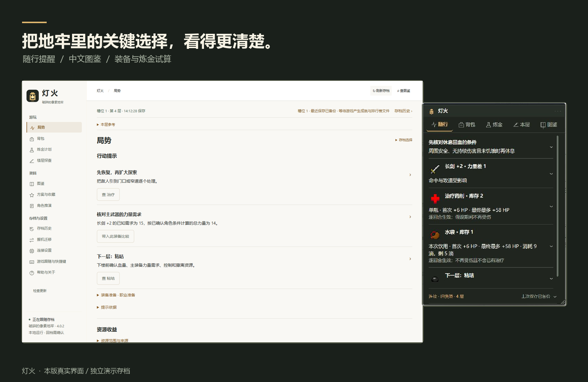
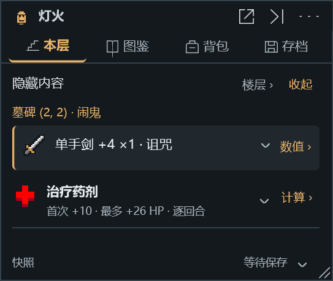
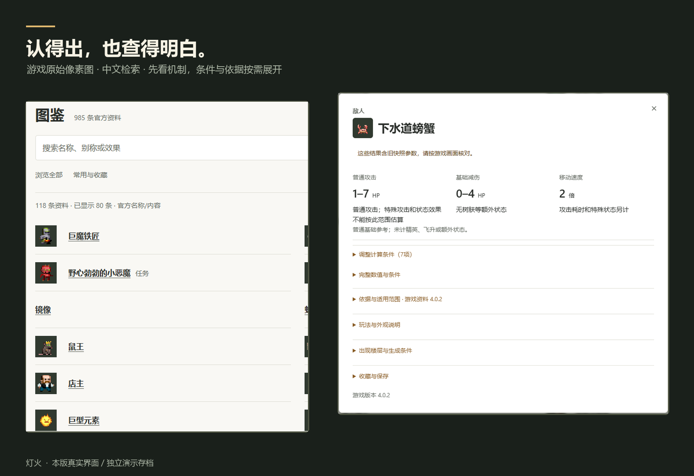
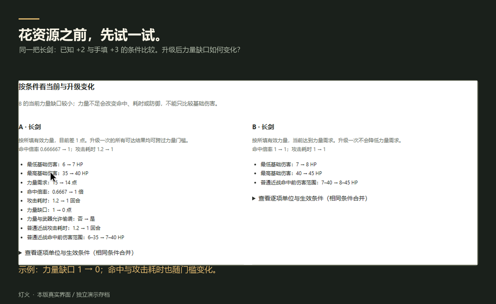
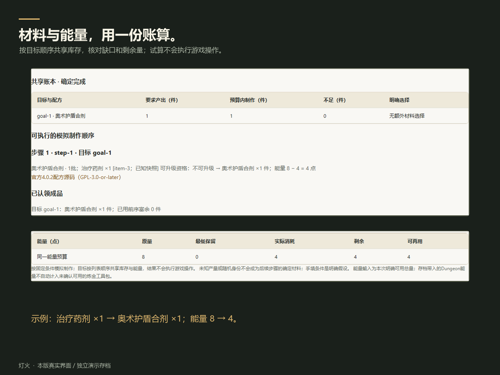
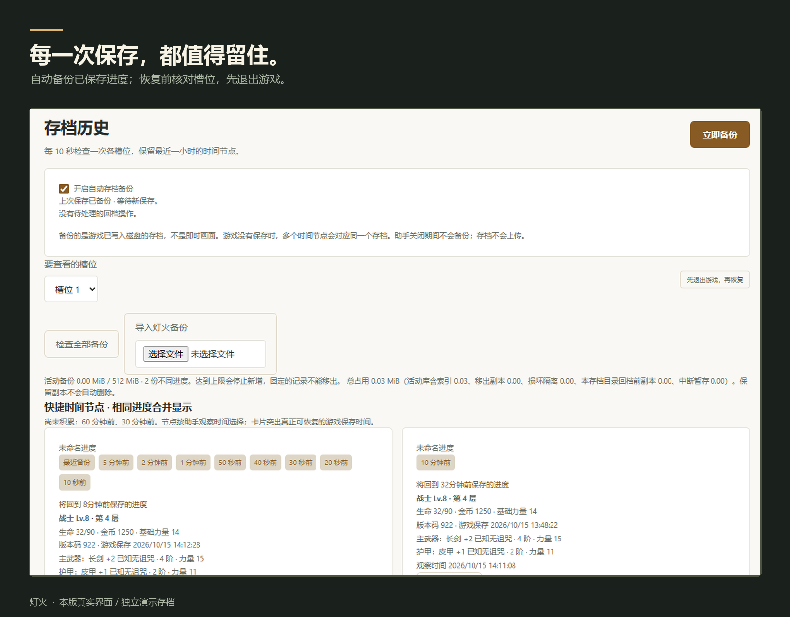

<h1 align="center">灯火</h1>

<strong>把地牢里的关键选择，看得更清楚。</strong> 《破碎的像素地牢》的 Windows 随行助手

<a href="https://room.riftbuddy.dpdns.org/denghuo/Denghuo-Setup.exe">下载 Windows 安装包</a> · <a href="https://github.com/Legender134/denghuo/releases/latest">GitHub 下载 / 免安装版</a> · <a href="https://github.com/Legender134/denghuo/releases/download/v0.7.0/denghuo-introduction-0.7.0.mp4">观看 36 秒操作短片</a>

力量还差多少，升级一卷够不够？现在喝药能恢复多少，正在生效的治疗还能回多少？下一层遇到的首领，有什么需要提前准备？

灯火读取游戏已经保存的进度，把影响选择的条件放在手边。需要时展开查看依据，专心游玩时收成一盏小灯。

**Windows 10 / 11 x64 · 安装后即可使用 · 无需 Python · 中文资料基于游戏 4.0.2**

## 游戏旁边，留给重要的事

随行窗口先显示行动限制、力量缺口和资源收益。生命与角色概况收进详情，完整说明点开再看。

窗口可以自由拖动、缩放，记住你的大小和位置；点灯收起，再点回到原来的页面。随游戏显示，切到其他应用时隐藏。想重新摆放，菜单里可以恢复默认布局。

## 查得到，也算得明白

物品、怪物、状态、天赋与技能集中在中文图鉴中。按名称、别称或用途查找，配合游戏原始像素图辨认；常用资料可以收藏。

资料可带入适用的已知角色条件，也能手动试算。治疗分清首次与总恢复量，装备分清力量门槛与升级变化，怪物掉落注明概率和触发条件。未知项保持待确认，详细数值与官方依据按需展开。

## 花资源之前，先试一试

从背包打开装备比较，核对力量需求、升级投入和剩余预算。炼金规划支持多个目标共享同一份库存与能量，查看材料缺口，再决定制作顺序。

有用的条件可以保存成方案；未完成的输入可保存为草稿，下次明确载入后继续编辑。

## 每一次保存，都值得留住

助手运行时自动备份已落盘的游戏进度。存档历史支持查看、命名、固定与导出；需要恢复时，先退出游戏，再核对目标槽位与进度。恢复前保留原件，并提供撤回上次回档的入口。

## 开始使用

1. 下载并安装，打开 **灯火**。免安装版请完整解压后运行 `灯火.exe`。
2. 开始或继续游戏。默认自动连接标准存档目录，并跟随最新有效槽位；自定义目录可在设置中选择。
3. 游戏保存后查看随行提示。更多资料与规划工具可在小窗口内打开，也可进入 **更多 → 完整面板**。

启动时会在后台检查更新。**更多 → 软件更新**可以手动检查、下载，确认后退出并安装；不会自动安装或中断游戏。设置、方案与备份保存在安装目录之外，更新会保留。

常用快捷键

| 快捷键 | 操作 |
| --- | --- |
| Ctrl + Alt + Q | 收起 / 展开随行窗口 |
| Ctrl + Alt + G | 开关游玩显示 |
| Ctrl + Alt + B | 备份已保存进度 |
| Ctrl + Alt + H | 打开图鉴 |
| Ctrl + Alt + T | 打开存档历史 |

可以在设置中修改或禁用。快捷键被其他软件占用时会提示。

## 使用前了解这几件事

- **数据来自存档快照。** 灯火不读取游戏内存，游戏尚未保存的变化不会即时出现；界面会标注旧快照。
- **保留探索的选择。** 未鉴定物品保持未知；已生成楼层中的隐藏信息需要主动揭示。概率和参考计算不代表下一次随机结果。
- **存档与分析留在本机。** 更新检查只获取公开版本信息，不上传存档、背包或方案。自动备份需要助手保持运行。
- **全屏兼容性取决于环境。** 推荐窗口化或无边框游玩，独占全屏下的覆盖显示与焦点行为可能受系统和显卡影响。

图片来自本版实际运行界面，演示使用独立测试存档；展示数值随角色与条件而变。灯火是独立开源项目，与游戏官方没有隶属或背书关系。

[使用指南](docs/guide.md) · [反馈问题](https://github.com/Legender134/denghuo/issues) · [开发指南](CONTRIBUTING.md) · [构建说明](BUILD.md) · [版本记录](CHANGELOG.md)

按 [GPL-3.0-or-later](LICENSE.txt) 开源。游戏名称、图像与参考规则的版权归原作者和贡献者，详见 [第三方声明](THIRD_PARTY_NOTICES.md)。
